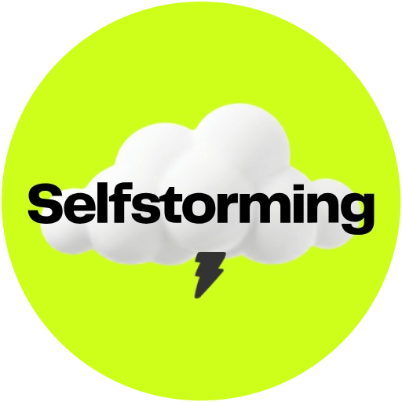

<p align="center"></p>

# Selfstorming MCP

**Curated marketing libraries and ideation for your AI.** Connect Selfstorming to Claude, ChatGPT, Codex, Claude Code, Cursor or any remote MCP client, and your assistant can work from your project context and from Selfstorming at the same time.

- **1,800+ award-winning campaigns**, each broken down to the brief, idea, creative mechanic, strategy and video analysis. Search by brief, mood or mechanic.
- **Marketing Wisdom**: 850+ sourced findings from WARC, Kantar, System1, Ipsos and the marketing canon, plus 61 marketing laws. Every answer names the original report.
- **Techniques and frameworks**: 100 creative techniques, 360 hooks, 66 naming techniques, 49 storytelling techniques, 50 creative strategy techniques and 52 strategy frameworks, with a diagram renderer.
- **Ideation, Naming and Hooks sessions** grounded in those libraries, saved to your Selfstorming account as boards.

This repository is the public listing for the hosted server: documentation, the registry manifest (`server.json`) and the LobeHub manifest (`lhm.plugin.json`). The server itself is operated by Selfstorming; there is nothing to install or self-host.

## Endpoint

```
https://www.selfstorming.com/api/mcp
```

- Transport: Streamable HTTP
- Authentication: OAuth 2.1 with dynamic client registration (log in with your Selfstorming account)
- Requires a [Selfstorming Pro](https://www.selfstorming.com/pricing) subscription. Free accounts can connect; tools answer with an upgrade message.

## Connect

**Claude (claude.ai, Desktop):** Settings > Connectors > Add custom connector > paste the URL > log in and allow access.

**Claude Code:**
```bash
claude mcp add --transport http selfstorming https://www.selfstorming.com/api/mcp
```

**ChatGPT (desktop):** Plugins > MCPs > Add server > name it "Selfstorming" > Type: Streamable HTTP > paste the URL > save > log in.

**Codex CLI:**
```bash
codex mcp add selfstorming --url https://www.selfstorming.com/api/mcp
codex mcp login selfstorming
```

**Cursor and other clients:** add a remote MCP server with the URL above and authenticate with your Selfstorming login.

## Example prompts

- "Read the brief in this project and find 5 campaigns that cracked the same problem."
- "Back every recommendation in this deck with a sourced stat."
- "Rewrite this paragraph with a storytelling technique that fits."
- "Selfstorm 10 ideas for this launch - big ideas and LinkedIn posts."
- "Fill the Brand Onion for this client and render it."

## Tools

29 tools. Every tool declares a title and `readOnlyHint` / `destructiveHint` / `openWorldHint` annotations.

### Campaign library

| Tool | Title | Access |
|---|---|---|
| `search_campaigns` | Search campaigns | read-only |
| `browse_campaigns` | Browse campaigns | read-only |
| `get_campaign` | Get campaign breakdown | read-only |
| `list_playlists` | List campaign playlists | read-only |
| `get_playlist` | Get campaign playlist | read-only |

### Marketing Wisdom

| Tool | Title | Access |
|---|---|---|
| `search_wisdom` | Search Marketing Wisdom | read-only |
| `get_wisdom_bite` | Get Wisdom finding | read-only |
| `browse_wisdom` | Browse Marketing Wisdom | read-only |

### Technique libraries

| Tool | Title | Access |
|---|---|---|
| `list_hooks` | List hook techniques | read-only |
| `list_creative_techniques` | List creative techniques | read-only |
| `list_naming_techniques` | List naming techniques | read-only |
| `list_storytelling_techniques` | List storytelling techniques | read-only |
| `list_strategy_techniques` | List creative strategy techniques | read-only |
| `get_strategy_technique` | Get creative strategy technique | read-only |
| `list_marketing_laws` | List marketing laws | read-only |
| `get_marketing_law` | Get marketing law | read-only |
| `list_ad_techniques` | List social ad techniques | read-only |

### Frameworks

| Tool | Title | Access |
|---|---|---|
| `list_frameworks` | List frameworks | read-only |
| `get_framework` | Get framework | read-only |
| `render_framework` | Render framework diagram | read-only |

### Your account

| Tool | Title | Access |
|---|---|---|
| `list_my_sessions` | List my sessions | read-only |
| `list_my_brands` | List my brands | read-only |

### Ideation (writes to your account)

| Tool | Title | Access |
|---|---|---|
| `create_ideation_session` | Create ideation session | writes |
| `generate_more_ideas` | Generate more ideas | writes |
| `generate_names` | Generate names | writes |
| `generate_hooks` | Generate hooks | writes |

### Social Ad Studio (coming soon)

| Tool | Title | Access |
|---|---|---|
| `create_ad_test` | Create ad test | writes |
| `generate_ad_concept` | Write ad concept | writes, destructive |
| `get_ad_test` | Get ad test | read-only |

Resource: `selfstorming://about` (what Selfstorming is, with canonical links).

## Data handling

- Selfstorming receives only the arguments your client passes to a tool (a query, a brief). It never receives your conversation or files.
- Briefs sent to ideation tools become sessions in your own Selfstorming account.
- Usage metadata (tool name, duration, success) is logged for reliability and analytics.
- Your briefs and sessions are never used to train AI models; Selfstorming calls models only through paid APIs whose terms exclude customer data from training.

Full details: [technical docs](https://www.selfstorming.com/tools/mcp/docs) · [privacy policy](https://www.selfstorming.com/legal/privacy) · [terms](https://www.selfstorming.com/legal/terms)

## Limits

Per-user fair-use limits (daily limits reset at 00:00 UTC): 500 generated ideas, names and hooks per day, 10 new sessions per day, 200 library lookups per day, 20 calls per minute. The Selfstorming web app has no such limits.

## Support

hello@selfstorming.com · [selfstorming.com/tools/mcp](https://www.selfstorming.com/tools/mcp)

Selfstorming is operated by Selfstorm s.r.o., Slovakia (EU).
